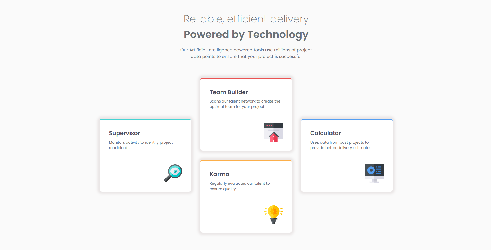
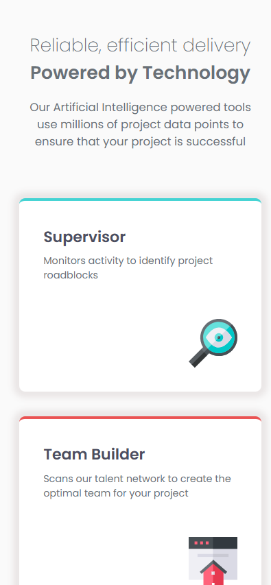

# Sección de cuatro tarjetas de características

[English version](./README.md)

Este repositorio contiene mi solución al reto [Four Card Feature Section de Frontend Mentor](https://www.frontendmentor.io/challenges/four-card-feature-section-weK1eFYK). El objetivo fue reproducir el diseño responsive proporcionado mientras construía una base de HTML y CSS semántica, accesible y fácil de mantener.

## Descripción general

La página presenta cuatro características de un producto en una disposición móvil de una sola columna y las reorganiza en una composición particular de tres columnas y dos filas para pantallas mayores. Se desarrolló sin JavaScript porque el reto no necesita comportamiento interactivo.

### Capturas

#### Escritorio

#### Móvil

### Enlaces

- [Sitio publicado](https://jesusaid.github.io/Four-Card-Feature-Section/)
- [Repositorio en GitHub](https://github.com/JesuSaid/Four-Card-Feature-Section)

## Tecnologías utilizadas

- HTML5 semántico
- Propiedades personalizadas de CSS
- Archivos locales de la fuente Poppins
- Flexbox
- CSS Grid
- Nombres de clases inspirados en BEM
- Propiedades lógicas de CSS
- Flujo responsive mobile-first
- Git y Conventional Commits

## Proceso de desarrollo

Comencé revisando el README del reto, la guía de estilos, las imágenes de referencia y los recursos disponibles. Antes de agregar estilos visuales, construí la estructura semántica con un encabezado principal, encabezados secundarios para cada característica y una lista no ordenada para la colección de tarjetas. Los iconos son decorativos, por lo que utilizan texto alternativo vacío.

Después establecí el sistema visual mediante tokens reutilizables de color y tipografía en `:root`. Poppins se carga localmente con los pesos requeridos —200, 400 y 600—, `font-display: swap` y una familia genérica de respaldo. Las imágenes y las fuentes se organizaron dentro de `assets`.

La disposición base se desarrolló con un enfoque mobile-first. Flexbox apila y centra las tarjetas, mientras que `inline-size` y `max-inline-size` permiten que ocupen el espacio de pantallas pequeñas sin crecer demasiado. A partir de `60rem`, la lista cambia a un Grid de tres columnas y dos filas que reproduce la composición de escritorio. El Grid deja de crecer al alcanzar `66rem`.

Cada tarjeta combina la clase compartida `features__item` con un modificador BEM. La clase base define el borde común y cada modificador proporciona un valor local para `--card-accent`. De esta manera, el color pertenece a la identidad de la tarjeta y no a su posición dentro de la lista.

El desarrollo se dividió en hitos de Git enfocados en la estructura semántica, las bases del sistema visual, los estilos móviles, la composición de escritorio, las correcciones finales de interfaz y la documentación.

## Lo que aprendí

### Estructura semántica antes de la presentación

Las dos líneas visualmente diferentes de la parte superior pertenecen a un único encabezado principal, no a dos niveles de encabezado sin relación. Las tarjetas forman una colección sin orden obligatorio y sus nombres funcionan como encabezados de segundo nivel. Separar el significado de la apariencia facilitó aplicar estilos sin debilitar la jerarquía del documento.

### Tamaños fluidos en lugar de anchos rígidos

Un ancho fijo o márgenes horizontales grandes pueden comprimir el contenido o provocar desbordamiento en pantallas estrechas. Combinar `inline-size: 100%` con un `max-inline-size` razonable permite que las tarjetas y el texto introductorio se adapten naturalmente desde 320px hasta viewports mayores.

### Elegir un breakpoint a partir del contenido

El breakpoint de escritorio se eligió comprobando el punto en el que tres tarjetas, dos espacios y el padding del contenedor podían convivir cómodamente. El valor de `60rem` permite activar la composición de escritorio en anchos comunes de laptop y conserva la columna única a 768px.

### Representar el diseño con el Grid más pequeño posible

El diseño de escritorio puede describirse mediante tres columnas y dos filas. Las tarjetas laterales abarcan ambas filas y permanecen centradas verticalmente, mientras Team Builder y Karma ocupan las celdas superior e inferior de la columna central. Una cuadrícula de seis columnas habría representado las mismas relaciones con pistas innecesarias.

### Variantes de componentes resistentes

Selectores como `:first-child` y `:nth-child()` relacionarían cada color con el orden actual del HTML. Los modificadores BEM mantienen el color unido a su tarjeta, por lo que reorganizar la lista no altera la identidad visual de los componentes.

### Propiedades lógicas y responsabilidad de los componentes

Propiedades como `padding-inline`, `padding-block`, `margin-block`, `inline-size` y `border-block-start` describen espacios y tamaños sin depender de una dirección de escritura concreta. El espacio exterior de la página pertenece al contenedor y no a la última tarjeta.

## Comprobaciones responsive y de accesibilidad

La implementación final se revisó en 320px, 375px, 768px, alrededor del breakpoint de `60rem`, 1024px y 1440px. También se comprobó con un nivel de zoom mayor para confirmar que el contenido permanezca accesible y que no aparezca desbordamiento horizontal.

Las consideraciones de accesibilidad incluyen:

- Un único `h1` seguido por encabezados `h2` correctamente ordenados.
- Una lista semántica para la colección de características.
- Atributos `alt` vacíos para iconos decorativos.
- Unidades relativas y anchos fluidos.
- Contraste de texto basado en la paleta proporcionada.
- Ausencia de animación o interacción esencial que requiera JavaScript.

## Desarrollo futuro

En proyectos futuros quiero continuar practicando:

- La elección de breakpoints a partir de las restricciones del contenido y no de etiquetas de dispositivos.
- La creación de composiciones más complejas con Grid sin pistas o contenedores innecesarios.
- La construcción de sistemas de espaciado consistentes con pocos tokens reutilizables.
- La validación de HTML, CSS, zoom y accesibilidad mediante teclado como parte de cada hito.
- La mejora de las comparaciones visuales de sombras, espacios y tipografía.

## Colaboración con IA

Utilicé ChatGPT como compañero de aprendizaje y revisión durante el reto. Me ayudó a evaluar decisiones de HTML semántico, razonar sobre tamaños fluidos, comprender la colocación mediante líneas de Grid, revisar modificadores BEM, planificar hitos coherentes de Git y preparar una lista de control de calidad final. Implementé y probé personalmente los cambios del proyecto, utilizando la retroalimentación para entender por qué funcionaba cada enfoque en lugar de copiar una solución completa.

## Autor

- GitHub: [@JesuSaid](https://github.com/JesuSaid)

## Agradecimientos

Reto y diseño proporcionados por [Frontend Mentor](https://www.frontendmentor.io/).
