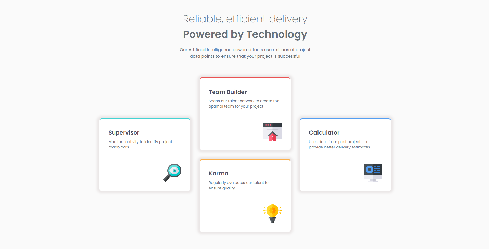
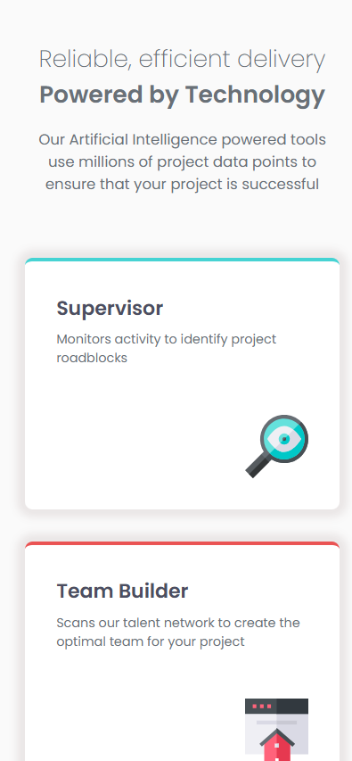

# Four Card Feature Section

[Versión en español](./README-es.md)

This repository contains my solution to the [Four Card Feature Section challenge on Frontend Mentor](https://www.frontendmentor.io/challenges/four-card-feature-section-weK1eFYK). The goal was to reproduce the provided responsive design while building a semantic, accessible, and maintainable HTML and CSS foundation.

## Overview

The page presents four product features in a single-column mobile layout and reorganizes them into a distinctive three-column, two-row composition on larger screens. It was built without JavaScript because the challenge does not require interactive behavior.

### Screenshots

#### Desktop

#### Mobile

### Links

- [Live site](https://jesusaid.github.io/Four-Card-Feature-Section/)
- [GitHub repository](https://github.com/JesuSaid/Four-Card-Feature-Section)

## Built with

- Semantic HTML5
- CSS custom properties
- Locally hosted Poppins font files
- Flexbox
- CSS Grid
- BEM-inspired class naming
- Logical CSS properties
- Mobile-first responsive workflow
- Git and Conventional Commits

## Development process

I began by reviewing the challenge README, style guide, reference images, and available assets. Before adding visual styles, I created the semantic document structure with one primary heading, secondary headings for each feature, and an unordered list for the card collection. The feature icons are decorative, so they use empty alternative text.

The visual system was then established with reusable color and typography tokens in `:root`. Poppins is loaded locally in the required weights—200, 400, and 600—with `font-display: swap` and a generic fallback. Images and fonts were organized under `assets`.

The base layout was developed mobile-first. Flexbox stacks and centers the feature cards, while `inline-size` and `max-inline-size` allow them to fill small viewports without becoming excessively wide. At `60rem`, the list changes to a three-column, two-row Grid that matches the desktop composition. The Grid itself stops growing at `66rem`.

Each card combines a shared `features__item` class with a BEM modifier. The base class defines the shared border, while each modifier supplies a local `--card-accent` value. This keeps the color attached to the card identity instead of its position in the list.

Development was divided into focused Git milestones for semantic structure, global design foundations, mobile styling, desktop layout, final UI corrections, and documentation.

## What I learned

### Semantic structure before presentation

The two visually different lines at the top belong to one primary heading rather than two unrelated heading levels. The cards form an unordered collection, and their names are second-level headings. Separating meaning from appearance made the document easier to style without weakening its hierarchy.

### Fluid sizing instead of rigid widths

Using a fixed width or large horizontal margins can compress content or create overflow on narrow screens. Combining `inline-size: 100%` with a reasonable `max-inline-size` lets the cards and introductory text adapt naturally between 320px and larger viewports.

### Choosing a breakpoint from the content

The desktop breakpoint was selected by testing where three cards, two gaps, and the container padding could coexist comfortably. A `60rem` breakpoint enables the desktop composition on common laptop widths while preserving the single-column layout at 768px.

### Modeling the layout with the smallest useful Grid

The desktop design can be represented with three columns and two rows. The side cards span both rows and remain vertically centered, while Team Builder and Karma occupy the upper and lower cells of the middle column. A larger six-column grid would have represented the same relationships with unnecessary tracks.

### Stable component variants

Selectors such as `:first-child` and `:nth-child()` would couple each accent color to the current HTML order. BEM modifiers keep each color attached to its feature card, so reordering the list does not change the visual identity of the cards.

### Logical properties and component ownership

Properties such as `padding-inline`, `padding-block`, `margin-block`, `inline-size`, and `border-block-start` describe spacing and sizing independently of a specific writing direction. Outer page spacing is owned by the container instead of being attached to the last card.

## Responsive and accessibility checks

The final implementation was reviewed at 320px, 375px, 768px, around the `60rem` breakpoint, 1024px, and 1440px. It was also checked at increased browser zoom to confirm that content remains reachable and that no horizontal overflow appears.

Accessibility considerations include:

- One `h1` followed by correctly ordered `h2` headings.
- Semantic list markup for the feature collection.
- Empty `alt` attributes for decorative icons.
- Relative units and fluid component widths.
- Sufficient text contrast based on the supplied palette.
- No essential animation or interaction requiring JavaScript.

## Continued development

In future projects I want to continue practicing:

- Selecting breakpoints from content constraints instead of device labels.
- Building more complex Grid layouts without unnecessary tracks or wrappers.
- Creating consistent spacing systems with a small set of reusable tokens.
- Validating HTML, CSS, zoom behavior, and keyboard accessibility as part of each milestone.
- Improving visual comparison techniques for shadows, spacing, and typography.

## AI collaboration

I used ChatGPT as a learning and review partner throughout the challenge. It helped me evaluate semantic HTML decisions, reason about fluid sizing, understand Grid line placement, review BEM modifiers, plan coherent Git milestones, and build a final quality-assurance checklist. I implemented and tested the project changes myself, using the feedback to understand why each approach worked rather than copying a complete solution.

## Author

- GitHub: [@JesuSaid](https://github.com/JesuSaid)

## Acknowledgments

Challenge and design provided by [Frontend Mentor](https://www.frontendmentor.io/).
